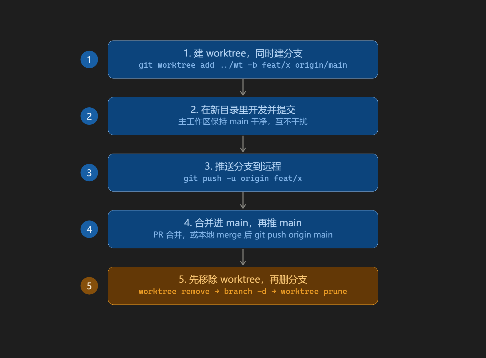

# 分支、工作树与合并

本页记录本仓库实际使用的入库流程，以及容易踩到的 git 细节。命令以 Windows PowerShell + Git Bash 均可执行为准。

## 先判断要不要工作树

| 情况 | 建议 |
| --- | --- |
| 单人、改动集中、本机已能跑测试 | 单目录切分支即可（见下节） |
| 需要主工作区随时停在 `main` 跑旧版本 | 用工作树 |
| 需要同时开两条互不相干的分支 | 用工作树 |
| 依赖重、且不想重装一遍 | 单目录切分支 |

工作树的隔离价值是「主工作区不动」，代价是**每个工作树都要重新准备依赖**（见「本项目的额外成本」）。

## 流程一：单目录切分支

```powershell
git switch -c feat/主题          # 工作区改动会随分支带过去
# 开发、提交、验证
git switch main
git merge --no-ff feat/主题 -m "merge: 中文摘要"
git branch -d feat/主题
git push origin main
```

开发期间主工作区不在 `main` 上。对本项目影响很小，因为构建产物、缓存、素材目录都在 `.gitignore` 里。

## 流程二：工作树隔离



上图为工作树流程的整体顺序。图中第 1 步的基线选择、第 5 步的清理细节，以下文为准。

```powershell
git fetch origin
git worktree add ../wt -b feat/主题 origin/main   # 以远程快照为基线
# 或
git worktree add ../wt -b feat/主题 main          # 以本地 main 为基线
```

**两条基线不能混用。** `fetch` 只更新 remote-tracking ref，对本地 `main` 没有任何影响；先用 `fetch` 再以本地 `main` 为基线，那个 `fetch` 是无效动作。

| 基线 | 含义 | 风险 |
| --- | --- | --- |
| `origin/main` | 远程最新快照 | 远程未同步时基线陈旧，需先 `fetch` |
| `main` | 本地分支 | 未推送的提交会成为新分支的祖先，并进入 PR 的 diff |

选择原则：**要让 PR 只包含本次改动，用 `origin/main`；本次工作本来就建立在未推送的本地提交上，用 `main`。**

开发完成后：

```powershell
git -C ../wt push -u origin feat/主题      # 走 PR 时
```

## 合并方式

| 方式 | 结果 | 何时用 |
| --- | --- | --- |
| `git merge --no-ff` | 保留合并点，`git log --graph` 可见侧分支 | 本仓库既有形态（`merge: …` 提交） |
| 默认 `git merge` | 主分支未前进时 fast-forward，**没有合并点** | 接受线性历史时 |
| squash / rebase | 线性历史，无 `merge:` 提交 | 团队约定线性历史时 |

本仓库历史里的 `merge: 中文摘要` 提交全部来自 `--no-ff`。若要保留同样的图形，`--no-ff` 是必要条件；去掉它，主分支会直接指向功能提交。

## 清理顺序

```powershell
git worktree remove ../wt          # 1. 先移除工作树
git branch -d feat/主题            # 2. 再删本地分支
git push origin --delete feat/主题 # 3. 第 3 步推过分支才需要
git worktree prune                 # 4. 仅手工删过目录时才有意义
```

- 分支被任何工作树占用时，`git branch -d` 会报 `cannot delete branch 'feat/主题' used by worktree at …`，必须先 `worktree remove`。
- `worktree remove` 遇到未提交改动或未跟踪文件会拒绝执行；`--force` 能删掉，但**会一并丢弃那些改动**。
- `git worktree remove` 成功后元数据已清理，`prune` 是空操作。它只处理「绕过 git 手工删掉目录」后残留的元数据。

## 本项目的额外成本

以下目录都被 `.gitignore` 排除，新工作树里一个都没有：

| 目录 | 缺失后果 | 恢复命令 |
| --- | --- | --- |
| `.venv/` | 离线测试无法运行 | `py -3 -m venv .venv` 后 `pip install -e ".[test]"` |
| `frontend/node_modules/` | 前端无法构建 | `npm.cmd --prefix frontend ci --ignore-scripts` |
| `runtimes/` | 无 Whisper 与 ffmpeg，转写及依赖它的浏览器测试失效 | `scripts/setup-local-tools.ps1` |
| `outputs/` | 无历史素材 | 按需复制或指向同一归档根 |
| `.local/` | 无缓存与任务日志 | 自动重建 |
| `frontend/dist/` | 无构建产物，工作台页面打不开 | `npm.cmd --prefix frontend run build` |

仓库里可能已有其他工作树（`git worktree list` 查看）。多一份 checkout 就意味着多一套依赖，注意别在两处各装一半。

## 提交信息格式

```text
type(scope): 祈使句标题

为什么需要这次改动，一段话说明问题。

做了什么，以及关键取舍。可以分多段。

验证方式与实际结果。
```

- `type` 取 `feat` / `fix` / `docs` / `test` / `refactor`；`scope` 取模块名（如 `subtitles`、`youtube`、`paths`）。
- **标题与正文之间必须留空行。** 缺空行时 git 会把首段整体当作 subject（`%s` 取的是第一个段落，不是第一行），日志和 PR 标题都会被撑长。已提交但未推送时用 `git commit --amend -F -` 补正。
- 合并提交统一写 `merge: 中文摘要`，与既有历史一致。

## 入库前检查

```powershell
git status                                   # 工作区干净，改动都已提交
git log --graph --oneline -5                 # 合并点是否符合预期
git diff --check                             # 无空白错误
.\.venv\Scripts\python.exe -X utf8 -m unittest discover -s tests/offline -p "test_*.py"
npm.cmd --prefix frontend run build
```

浏览器检查按改动范围选择执行，例如：

```powershell
.\.venv\Scripts\python.exe -m tests.browser.browser_subtitle_proofread
```

纯文档改动只检查 Markdown、文件结尾与 `git diff --check`，不运行无关的构建与测试。

## 常见现象对照

| 现象 | 原因 | 处理 |
| --- | --- | --- |
| `cannot delete branch … used by worktree` | 分支仍被工作树占用 | 先 `git worktree remove` |
| 合并后没有 `merge:` 提交 | 默认 fast-forward | 改用 `git merge --no-ff` |
| 提交标题把正文首段吞了 | 标题与正文间缺空行 | `git commit --amend -F -` |
| `worktree remove` 拒绝执行 | 工作树有未提交内容 | 先提交，或确认后 `--force` |
| 工作树里测试全挂 | `.venv` / `node_modules` / `runtimes` 不存在 | 按上表重装，或改用流程一 |
| `fatal: '…' already exists` | 目标目录已存在 | 换路径，或先移除旧工作树 |
